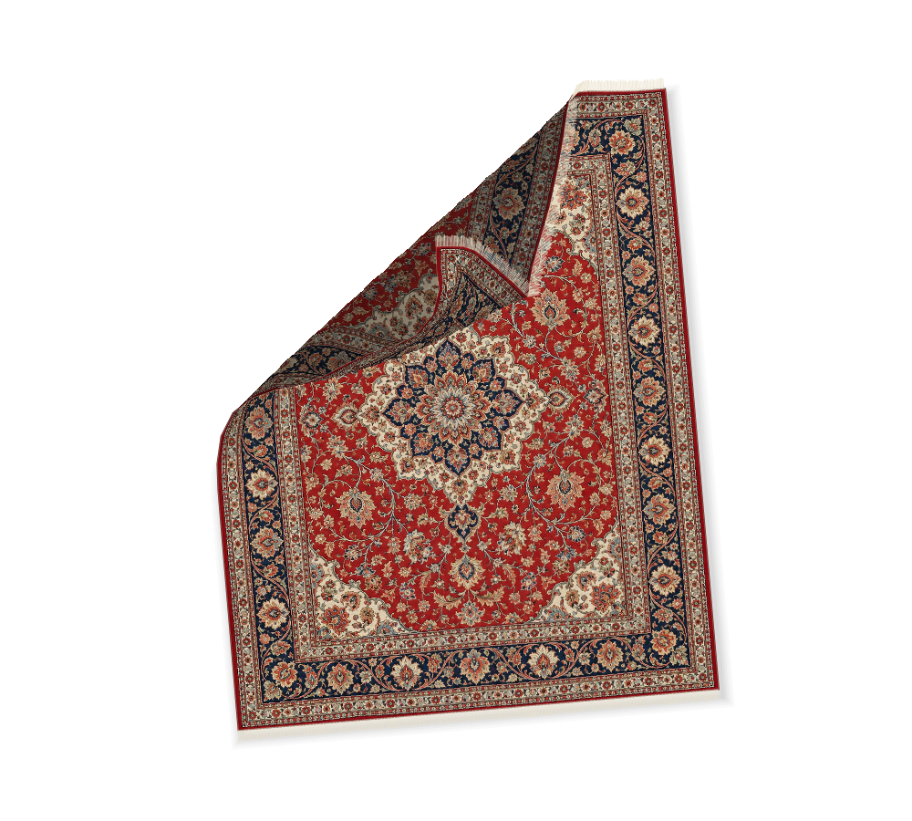
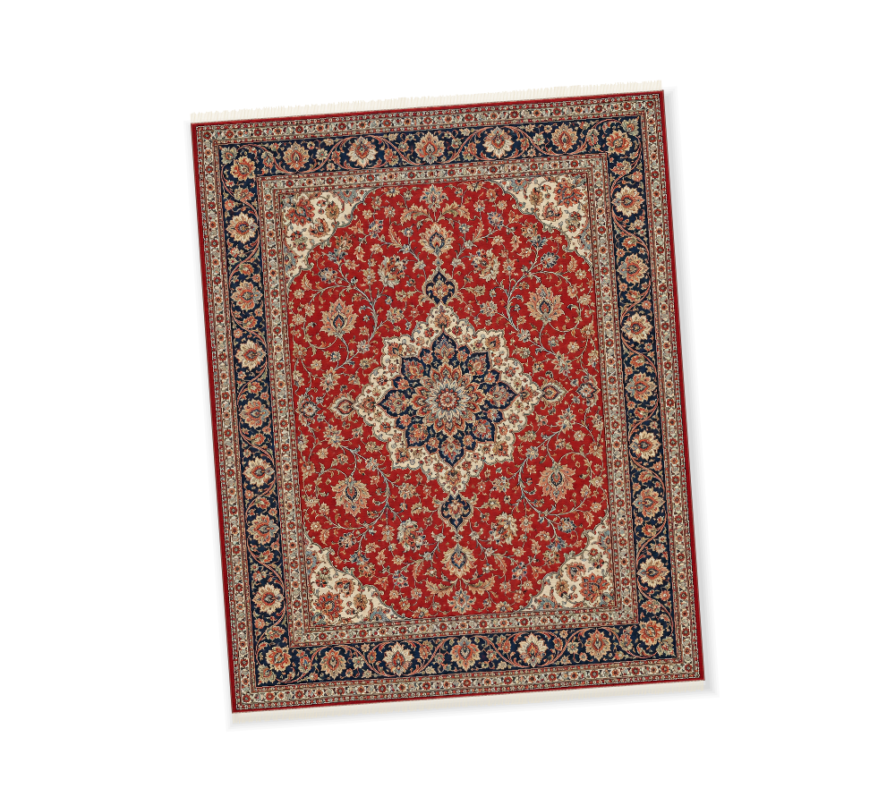
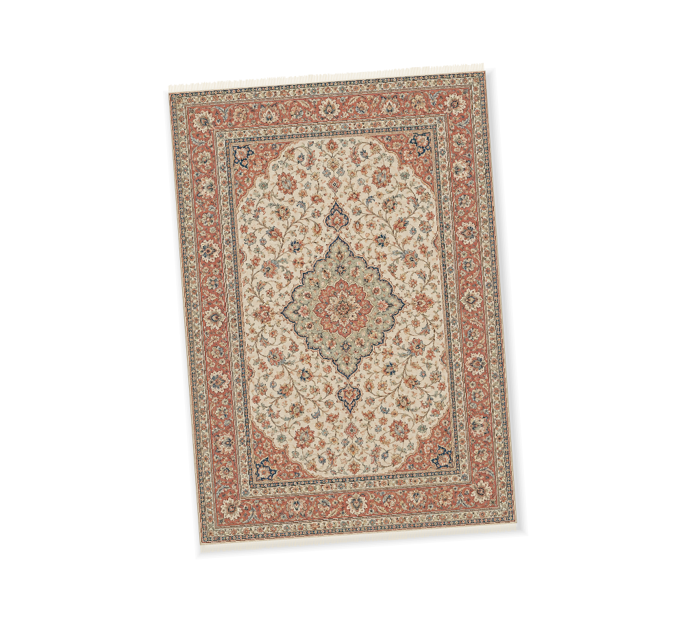
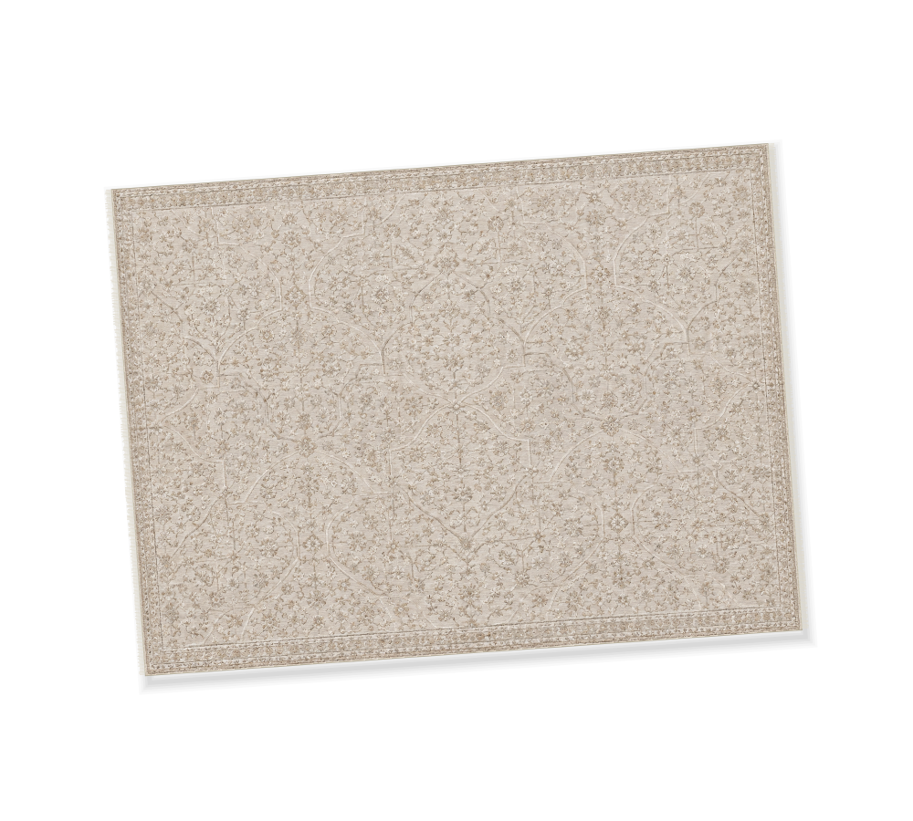
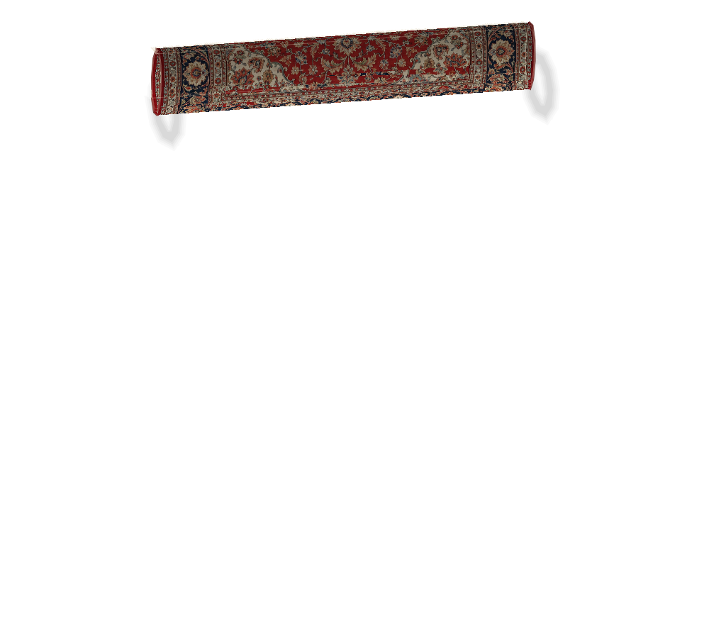

# Desktop Rug

A native Windows rug that you can drag, lift and fold over your **real desktop icons**. Three detailed reference-based materials, tactile cloth motion, a system tray, and an instant escape hatch. Your files never move.



**0.4 preview — Windows 10/11, x64.** Includes three detailed replacement rugs with individual proportions, corrected click/drag/roll behavior, English/Persian settings and tray menus, persistent desktop layering, continuous cross-monitor cloth and customizable Peek. Physical Windows 11, mixed-DPI hardware, touch/pen devices and disruptive shell/session checks still need verification. See [requirement coverage](docs/REQUIREMENTS.md) and [validation](docs/VALIDATION.md).

## Use it

Download **Setup-x64.exe** from [GitHub Releases](https://github.com/vahidpourreza/DesktopRug/releases) for a per-user installation, Start Menu shortcut and uninstaller. No administrator rights are required. Setup does not enable sign-in startup or launch the app automatically; the desktop shortcut is optional. Uninstall preserves your settings and custom images.

The portable Windows ZIP is also available: extract it and keep the license notices with the executable. Before installing, upgrading or switching copies, **Exit** the running copy from its tray menu. Saved settings are shared and retained. If a portable copy previously owned sign-in startup, disable it there before enabling startup from the installed copy.

Launch `DesktopRug.exe`, then visit your desktop with **Win+D**. The rug stays above desktop icons and below ordinary application windows, including exposed desktop areas while another app is active. It sleeps when settled or fully covered. Look for the little rug in the notification area (including the hidden-icons overflow).

| Gesture | Action |
| --- | --- |
| Drag the middle | Move the rug across displays with fabric inertia |
| Pull a corner | Lift and fold the fabric |
| Release | Let it settle |
| Right-click | Peek: hide the rug for eight seconds |
| Mouse wheel | Rotate five degrees |
| Double-click | Roll / unroll the rug |
| **Ctrl+Alt+Esc** | **Emergency hide** |
| Ctrl+Alt+R | Show / hide |
| Ctrl+Alt+P (customizable) | Activate Peek |
| Tray menu | Flatten, resize, pattern, settings, exit |

Peek hides every rendering and input surface so the real desktop receives clicks directly. Choose timed, toggle, or hold-the-shortcut activation, a custom chord, and optional right-click activation in settings. For hold mode, the tray and right-click use timed Peek so they remain usable without a held key. Rebinding a conflicting shortcut preserves the previous binding. **Hide rug** remains hidden until explicitly shown again. If the emergency shortcut cannot be registered, the rug stays hidden and settings explain the conflict.

Settings include Rich red Persian, Light ivory Persian, and Neutral tonal materials, four sizes plus scale adjustment, rotation, lighting, shadow, weave detail, an initial monitor and an optional local image. Built-in artwork comes from the supplied reference PNGs, embedded unchanged and sampled at high resolution; the portrait and landscape proportions and fringe placement follow each design. See [material details](docs/MATERIALS.md). Custom images are fitted without cropping or overwriting the source. Mouse, touch and pen use the same cloth gestures; pen pressure can control corner lift. Synthetic fabric sounds vary subtly and are off by default. Economy uses a smaller grid and a 30 Hz target; Balanced and High use a composition-driven 60 Hz target when hardware allows.

A plain click no longer starts unfolding a roll; an actual drag begins after the Windows movement threshold. Double-click toggles roll/unroll, and smooth-wheel deltas accumulate correctly. Language, sound, Peek, startup, icon-bump, shadow and lighting changes retain the current mesh instead of flattening it.

Choose **Settings → Language → English / فارسی**. The settings window previews the selected language immediately without discarding other unsaved edits. **Save changes** persists it and updates the tray menu; **Cancel** keeps the saved language. Persian uses right-to-left layout while shortcuts, filenames and rug artwork keep their original orientation. Preferences, including language, are stored in `%LOCALAPPDATA%\DesktopRug\settings.json`.

| Rich red Persian | Light ivory Persian | Neutral tonal |
| --- | --- | --- |
|  |  |  |



## Build and run

Requires Windows and the **.NET 10 SDK**. No administrator privileges, account, database or backend.

```powershell
dotnet restore DesktopRug.slnx --locked-mode
dotnet build DesktopRug.slnx -c Release --no-restore
dotnet test tests/DesktopRug.Tests/DesktopRug.Tests.csproj -c Release --no-build --no-restore
dotnet run --project src/DesktopRug.App -c Release --no-build
```

If your network stalls NuGet HTTP/2 downloads, retry in that terminal with `$env:DOTNET_SYSTEM_NET_HTTP_SOCKETSHTTPHANDLER_HTTP2SUPPORT='false'`. This is a build-time workaround; the app itself has no network dependency.

Create a self-contained portable Windows executable:

```powershell
dotnet publish src/DesktopRug.App/DesktopRug.App.csproj -c Release -r win-x64 --self-contained true -p:PublishSingleFile=true -p:IncludeNativeLibrariesForSelfExtract=true -o artifacts/publish/win-x64
```

Keep any accompanying notice files with the executable. Native runtime libraries are extracted by .NET at launch. The portable build needs no installation; the release also includes setup. Both downloads are unsigned, so Windows may display its usual downloaded-app warning. See [setup compilation and release checks](docs/RELEASING.md).

## Safety and local data

- No moving, deleting, renaming, hiding, copying or rearranging desktop files or shortcuts. No Explorer injection or shell extension.
- Explorer's accessibility API supplies icon labels and screen rectangles; these stay in memory. Logs contain no icon labels, paths or desktop screenshots.
- No telemetry or runtime network calls. Preferences and bounded logs live in `%LOCALAPPDATA%\DesktopRug`.
- Corrupt settings are backed up before defaults are used; settings saves use a temporary file and atomic replacement.
- Launch at sign-in is opt-in. It writes only `HKCU\Software\Microsoft\Windows\CurrentVersion\Run\DesktopRug`; disabling removes only that entry. Disable this option before deleting a portable copy.
- Exit from the tray completely removes the overlay. Running a second copy signals the first instance to show the rug.

## Verification and limitations

An unobtrusive smoke test creates windows outside the display, inspects the real shell read-only, renders pattern/fold/settings images and writes a local report:

```powershell
& 'artifacts/publish/win-x64/DesktopRug.exe' --diagnostics artifacts/diagnostics
```

It checks real shell discovery, actual native hit testing and mouse-message handling in owned off-screen fixtures, shared 100%/150% coordinate views, singleton kernel objects, persistence failures, rendering parity and performance. It does **not** move your pointer, activate an app, restart Explorer, alter a physical display or exercise real desktop icon activation. Simulated touch/pen and monitor views are identified separately from hardware evidence.

One cloth simulation is rendered through a separate window pair on each monitor. Dragging across a mixed-DPI boundary preserves physical screen position and size; the scale preference records the result for relaunch. Explorer notifications trigger icon updates, with a fast 50 ms drag refresh and an idle fallback. Explorer can still delay exposing a dragged item's position until drop.

Roll/unroll is an animated material-preserving guide, with free cloth physics resuming when grabbed. Swept vertex/triangle contacts substantially reduce fold penetration; pathological edge–edge crossings are not mathematically eliminated. Performance reports distinguish CPU raster timing from WPF/native pipeline timing and from physical display presentation. Setup is included at the user's request; its availability does not mean the physical acceptance checklist is complete.

See [architecture](docs/ARCHITECTURE.md), [Windows integration](docs/WINDOWS_INTEGRATION.md), [manual checks](docs/MANUAL_TESTS.md), and [validation evidence](docs/VALIDATION.md).

Each completed change set receives a versioned GitHub preview with a portable Windows download; see [the release workflow](docs/RELEASING.md).
