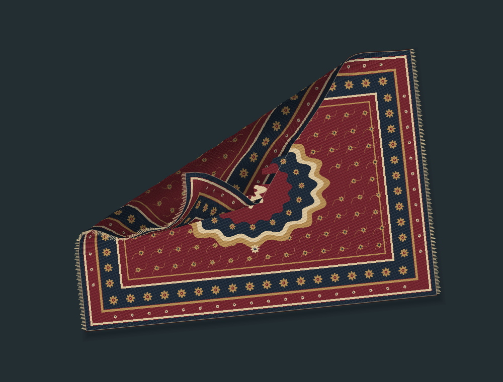
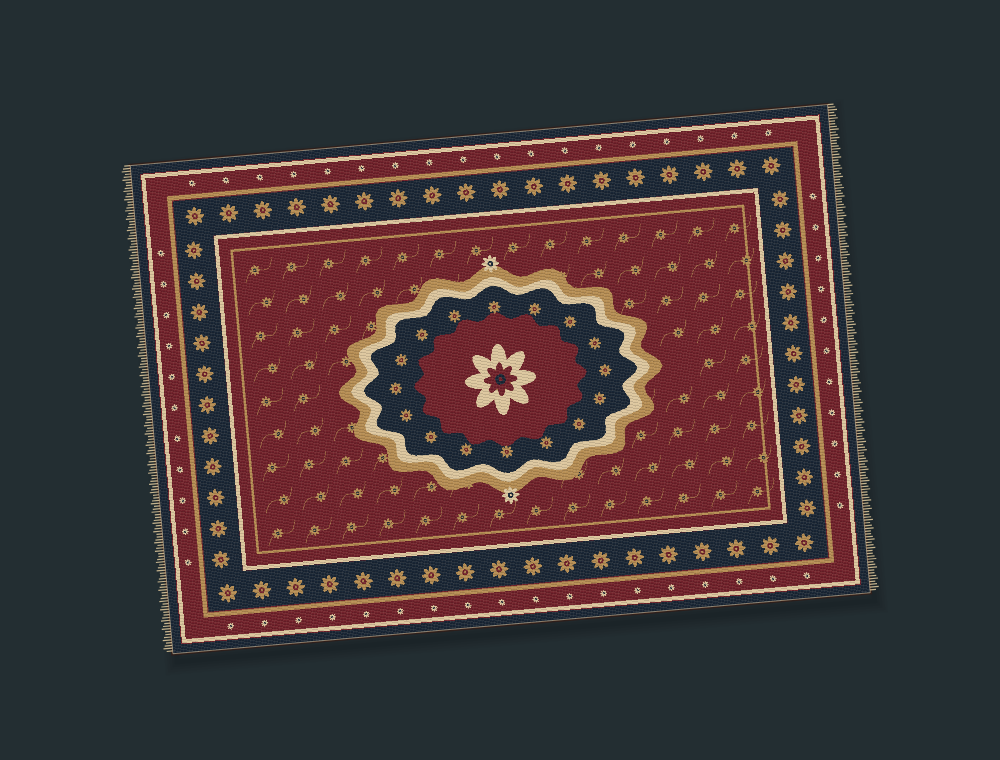
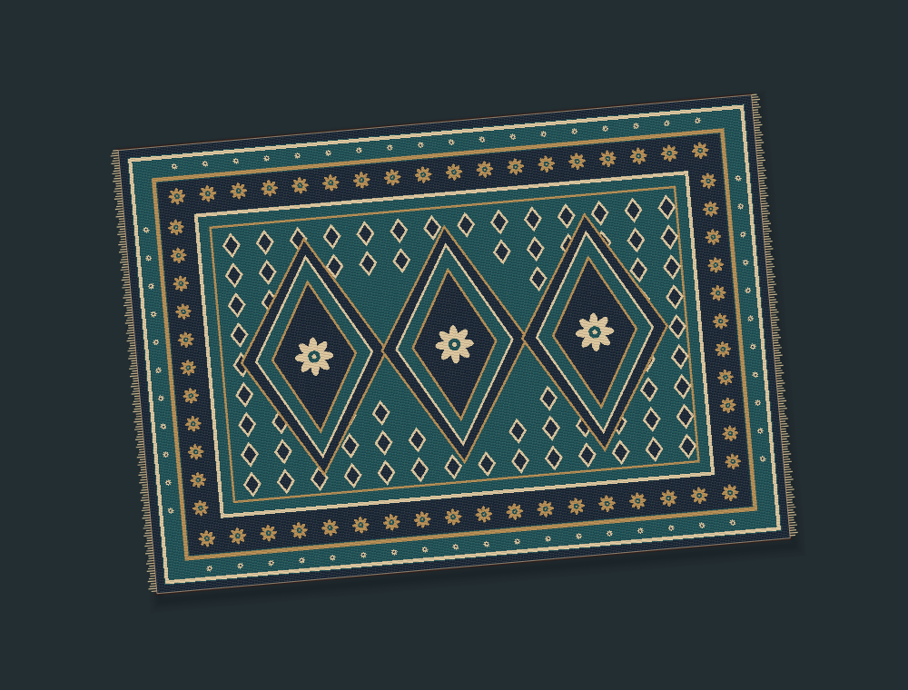
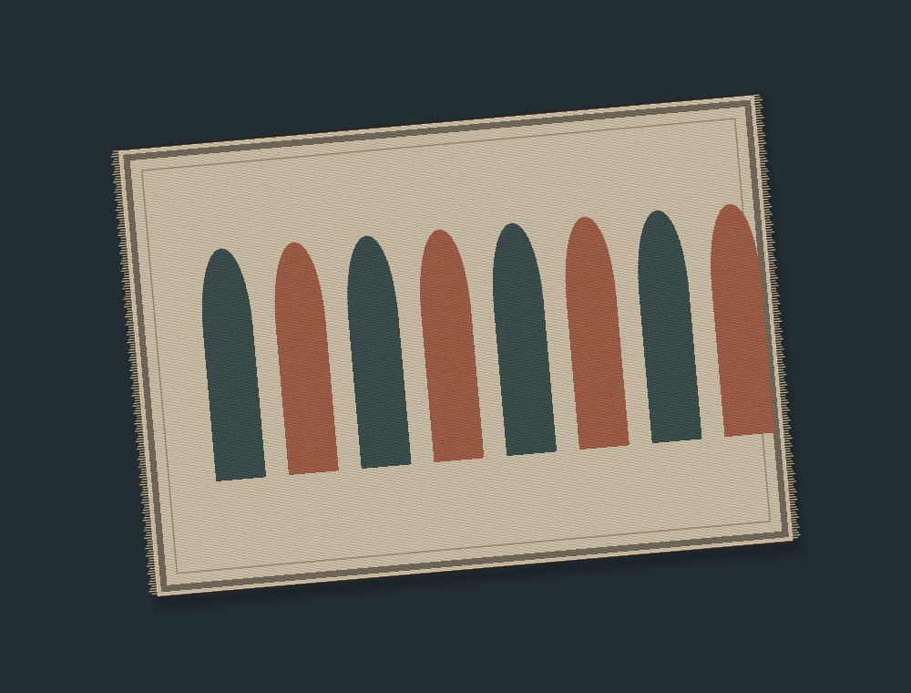

# Desktop Rug

A native Windows rug that you can drag, lift and fold over your **real desktop icons**. Three original woven designs, tactile cloth motion, a system tray, and an instant escape hatch. Your files never move.



**Preview build — Windows 10/11, x64.** Release compilation, automated physics tests and off-screen Windows checks pass. Hands-on desktop interaction, Windows 11, and mixed-DPI multi-monitor scenarios still need manual verification. See [validation](docs/VALIDATION.md).

## Use it

Launch `DesktopRug.exe`, then visit your desktop with **Win+D**. The rug appears when the desktop has focus; it rests while you work in another app. Look for the little rug in the notification area (including the hidden-icons overflow).

| Gesture | Action |
| --- | --- |
| Drag the middle | Move the rug with a little fabric inertia |
| Pull a corner | Lift and fold the fabric |
| Release | Let it settle |
| Right-click | Peek: hide the rug for eight seconds |
| Mouse wheel | Rotate five degrees |
| Double-click | Toggle a compact strip |
| **Ctrl+Alt+Esc** | **Emergency hide** |
| Ctrl+Alt+R | Show / hide |
| Ctrl+Alt+P | Start / end Peek |
| Tray menu | Flatten, resize, pattern, settings, exit |

Peek hides both the rendering and input windows so the real desktop receives clicks directly. Change its duration in settings. **Hide rug** remains hidden until explicitly shown again. If the emergency shortcut cannot be registered, the rug stays hidden and settings explain the conflict.

Settings include Kashan-inspired, Tabriz-inspired and modern original procedural designs, four sizes, rotation, lighting, shadow, weave detail, a monitor selector and an optional local image. Custom images are fitted without cropping or overwriting the source. Synthetic fabric sounds are off by default. Economy quality uses a smaller grid and a 30 Hz display timer; Balanced and High target 60 Hz when hardware allows.

| Kashan | Tabriz | Modern |
| --- | --- | --- |
|  |  |  |

## Build and run

Requires Windows and the **.NET 10 SDK**. No administrator privileges, account, database or backend.

```powershell
dotnet restore DesktopRug.slnx --locked-mode
dotnet build DesktopRug.slnx -c Release --no-restore
dotnet test tests/DesktopRug.Tests/DesktopRug.Tests.csproj -c Release --no-build --no-restore
dotnet run --project src/DesktopRug.App -c Release --no-build
```

If your network stalls NuGet HTTP/2 downloads, retry in that terminal with `$env:DOTNET_SYSTEM_NET_HTTP_SOCKETSHTTPHANDLER_HTTP2SUPPORT='false'`. This is a build-time workaround; the app itself has no network dependency.

Create a self-contained portable Windows executable:

```powershell
dotnet publish src/DesktopRug.App/DesktopRug.App.csproj -c Release -r win-x64 --self-contained true -p:PublishSingleFile=true -p:IncludeNativeLibrariesForSelfExtract=true -o artifacts/publish/win-x64
```

Keep any accompanying notice files with the executable. Native runtime libraries are extracted by .NET at launch. No installer is required. The executable is unsigned, so Windows may display its usual downloaded-app warning. No signing certificate or installer is included.

## Safety and local data

- No moving, deleting, renaming, hiding, copying or rearranging desktop files or shortcuts. No Explorer injection or shell extension.
- Explorer's accessibility API supplies icon labels and screen rectangles; these stay in memory. Logs contain no icon labels, paths or desktop screenshots.
- No telemetry or runtime network calls. Preferences and bounded logs live in `%LOCALAPPDATA%\DesktopRug`.
- Corrupt settings are backed up before defaults are used; settings saves use a temporary file and atomic replacement.
- Launch at sign-in is opt-in. It writes only `HKCU\Software\Microsoft\Windows\CurrentVersion\Run\DesktopRug`; disabling removes only that entry. Disable this option before deleting a portable copy.
- Exit from the tray completely removes the overlay. Running a second copy signals the first instance to show the rug.

## Verification and limitations

An unobtrusive smoke test creates windows outside the display, inspects the real shell read-only, renders pattern/fold/settings images and writes a local report:

```powershell
.artifacts\publish\win-x64\DesktopRug.exe --diagnostics .\artifacts\diagnostics
```

It does **not** move your pointer, activate an app, restart Explorer, alter a display, test real icon activation, or prove end-to-end desktop behavior. Do not treat it as the manual checklist.

One rug belongs to one monitor. Choose a different monitor in settings; continuous dragging across monitors is not implemented. Compact mode is a short strip, not a physically simulated roll. Particle self-contact reduces fold intersections but is not a full triangle collision solver. Icon updates are polled and may lag a drag. The CPU renderer has a 60 Hz target, not a verified 60 FPS guarantee.

See [architecture](docs/ARCHITECTURE.md), [Windows integration](docs/WINDOWS_INTEGRATION.md), [manual checks](docs/MANUAL_TESTS.md), and [validation evidence](docs/VALIDATION.md).
